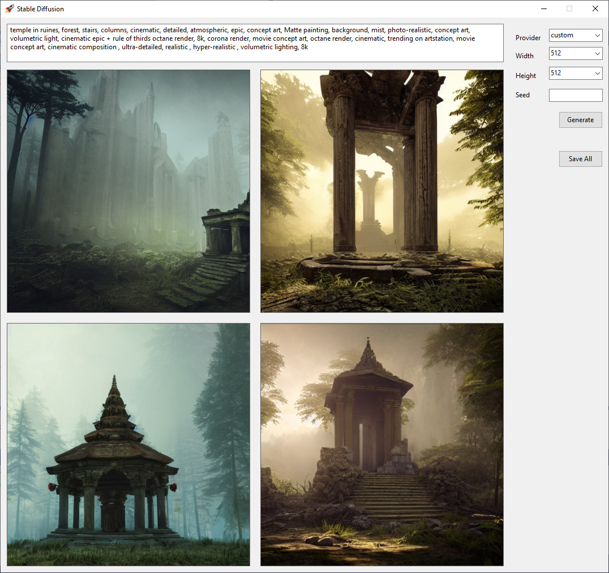

#  Replicate.Net
A C# client (using [RestEase](https://github.com/canton7/RestEase)) for [Replicate](https://replicate.com): A latent text-to-image diffusion model capable of generating photo-realistic images given any text input.

It implements the [HTTP API](https://replicate.com/docs/reference/http) from Replicate](https://replicate.com).

## Install
| | |
| - | - |
| [](https://www.nuget.org/packages/Replicate.Net) | Main project
| [](https://www.nuget.org/packages/Replicate.Net.DependencyInjection) | Support for Microsoft DependencyInjection

## Example (using Factory)
``` c#
var factory = new PredictionsApiFactory();

var replicateApi = factory.GetApi("{token}");

var request = new Request
{
    Version = "a9758cbfbd5f3c2094457d996681af52552901775aa2d6dd0b17fd15df959bef",
    Input = new DefaultPredictionInput
    {
        Prompt = "a gentleman cat with blue eyes wearing a tophat in a 19th century portrait"
    }
};

var response = await replicateApi.CreatePredictionAndWaitOnResultAsync(request).ConfigureAwait(false);
```

## Example (using DependencyInjection)
``` c#
// ---
    services.AddReplicateClient("{token}");
// ---


var replicateApi = // injected

// Now call the api
```


<hr>


## Example WinForms application




<hr>

### References
- https://replicate.com
- https://mpost.io/best-100-stable-diffusion-prompts-the-most-beautiful-ai-text-to-image-prompts/
- https://github.com/joelparkerhenderson/stable-diffusion-image-prompt-gallery


## Sponsors

[Entity Framework Extensions](https://entityframework-extensions.net/?utm_source=StefH) and [Dapper Plus](https://dapper-plus.net/?utm_source=StefH) are major sponsors and proud to contribute to the development of **Replicate.Net** and **Replicate.Net.DependencyInjection**.

[](https://entityframework-extensions.net/bulk-insert?utm_source=StefH)

[](https://dapper-plus.net/bulk-insert?utm_source=StefH)
